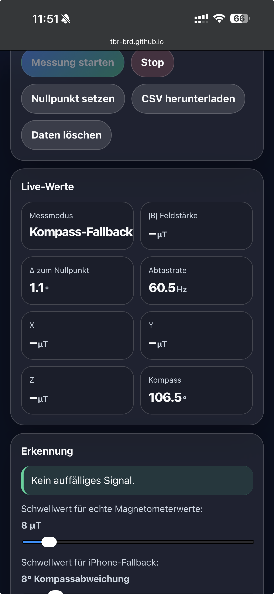
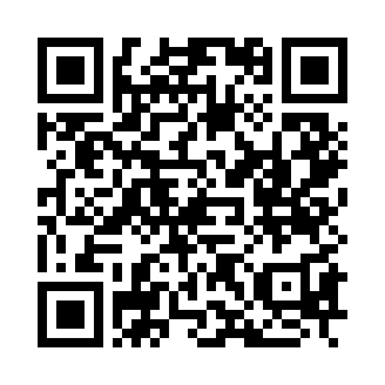

# Magnetic Field Measurement iPhone

[🇩🇪 Deutsch](README.md) · 🇬🇧 English

Local web app for magnetic field / compass measurement in the browser.

## Note on measuring

On the iPhone, Safari currently does not provide real magnetometer values in µT.  
On iPhone the web app therefore only uses the compass heading as a fallback.

So the iPhone does not show X/Y/Z magnetic field values, only changes in the compass heading.  
This can be used for simple interference tests, but it is not a real magnetic field measurement.



## Android / T Phone 3

On Android devices such as the T Phone, the app can be used in compass/orientation mode.

Real magnetometer values in µT via the Web Magnetometer API are currently not reliably available in Chrome for Android, because the API is disabled by default or still experimental.

Tested in practice on the T Phone, with the same readings as the iPhone.

## Start

Open this link on your iPhone:
https://tbr-brd.github.io/magnetfeld-messung-iphone/

Run locally:
```bash
python3 -m http.server 8080
```

For iPhone sensors: use HTTPS.

## Privacy

No data is sent to a server. The CSV stays local.

<br>
<a href="https://www.buymeacoffee.com/thoralf.brandt" target="_blank">
  
</a>
<br>

Open on your iPhone


